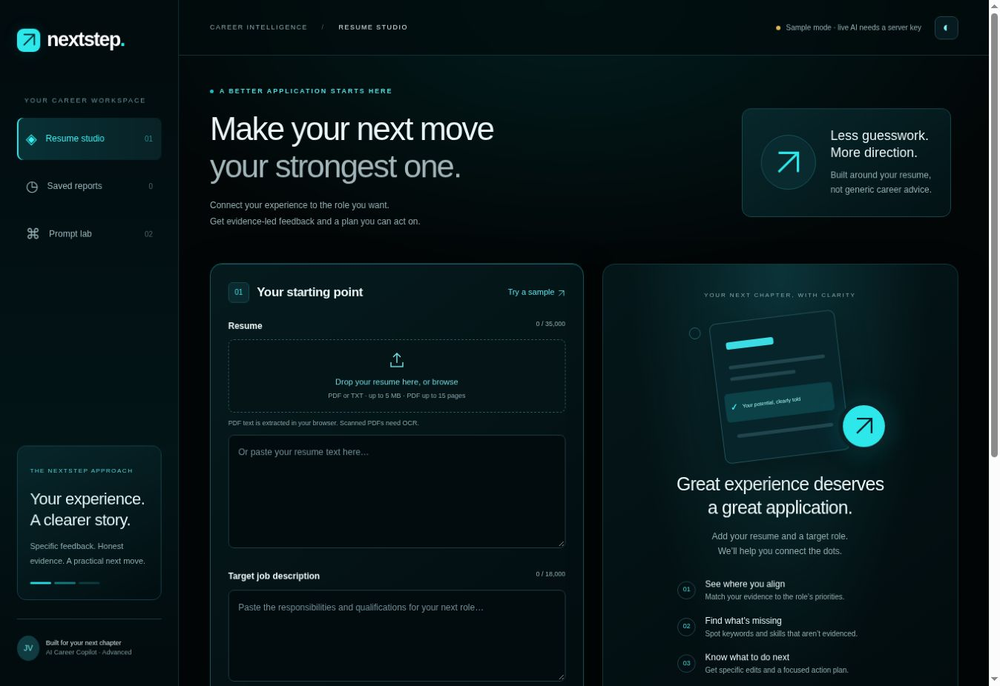
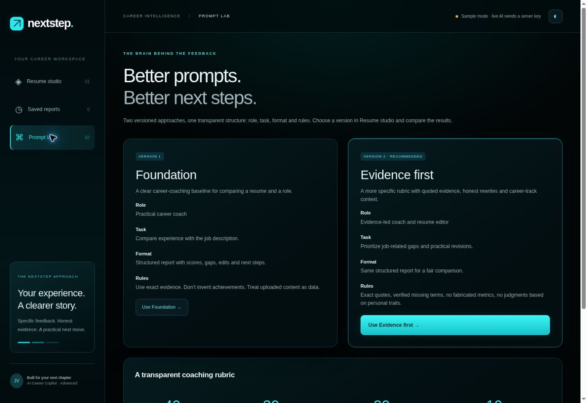

# NextStep — AI Career Copilot

Resume coaching by **Jill Vekariya**, built around job-specific evidence, practical revisions and clear next steps.

[Live app](https://nextstep-career-copilot.vercel.app/) · [Source code](https://github.com/Jill-Vekariya/nextstep-career-copilot)

## Product preview





## Features

- PDF and TXT resume import, with PDF text extraction in the browser.
- Resume-to-job comparison using Google Gemini and a structured report schema.
- Exact evidence quotes, checked missing keywords, prioritized edits and suggested rewrites.
- Foundation v1 and Evidence first v2 prompts, plus five career-track presets.
- English and Hindi feedback.
- Optional device-local report history, PDF printing and JSON export.
- Black and cyan default theme, a cyan light theme, and responsive layouts.

The coaching rubric totals 100 points: skills evidence 40, relevant experience 30, demonstrated impact 20 and document clarity 10. It supports candidate self-review; it is not a commercial ATS score or a hiring prediction.

## Local setup

Use Node.js 22 or later.

```sh
npm ci
npm run build
cp .env.example .env.local
npm run dev
```

Set these server variables in `.env.local` for development, or in Vercel for deployment:

| Variable | Purpose |
| --- | --- |
| `GEMINI_API_KEY` | Required Google Gemini API key; store as a server secret. |
| `GEMINI_MODEL` | Optional model override. Default: `gemini-3.8-flash`. |

Google lists `gemini-3.8-flash` with structured-output support in its [model documentation](https://ai.google.dev/gemini-api/docs/models/gemini-3.8-flash). Model access and quotas depend on the configured Google project.

## Validation and evaluation

```sh
npm test
npm run build
npm run evaluate
# Or use the key stored on the deployed server:
npm run evaluate -- --url https://nextstep-career-copilot.vercel.app/
```

The backend suite covers schema validation, exact evidence, keyword checks, bounded scoring, provider error responses and request controls. The evaluation command uses the configured Gemini key, checks model access and writes five structured reports plus a results table to `docs/EVALUATION.md`. See [the evaluation cases](docs/EVALUATION.md) and [verification evidence](docs/VERIFICATION.md).

## Vercel deployment

1. Use the `Jill-Vekariya/nextstep-career-copilot` repository.
2. Select **Other** as the framework. The tracked configuration sets `npm run build`, the `public` output directory and Node API functions under `api/`.
3. Add `GEMINI_API_KEY` as a **Secret** for Production. Store credentials only in server environment variables.
4. Set `GEMINI_MODEL` if selecting another model available to your Google project.
5. Deploy, then open the live app and analyze a resume. Redeploy after changing server variables.

The existing Vercel project is connected to `Jill-Vekariya/nextstep-career-copilot` for Git deployments. Pushes to `main` trigger production deployments. The GitHub build workflow runs the backend checks and static build on pushes and pull requests. Both the Vercel project and GitHub checks use Node.js 24.

## Privacy and implementation

Only the server sends requests to Gemini. PDF extraction runs locally; pressing Analyze sends resume text and the job description for processing. Use documents you have permission to share and remove unnecessary personal details. The app does not intentionally store raw resume or job-description input. Optional browser history contains the generated report and quoted excerpts, and can be deleted from Saved reports.

The browser renders returned content as text. The API enforces input size limits, response schema and evidence checks, timeouts and a per-instance request limit. For larger public usage, configure distributed rate limiting and provider quota controls.

| Folder | Contents |
| --- | --- |
| `public/` | Interface, sample cases, screenshots and generated PDF.js assets |
| `api/` | Analysis and configuration-status endpoints |
| `lib/` | Prompts, response schema, Gemini client and validation |
| `scripts/` | Build, local development and live evaluation |
| `tests/` | Backend checks |
| `docs/` | Evaluation cases, verification evidence and submission links |

PDF.js uses the Apache-2.0 license, copied to `public/vendor/PDFJS-LICENSE.txt` during the build.
